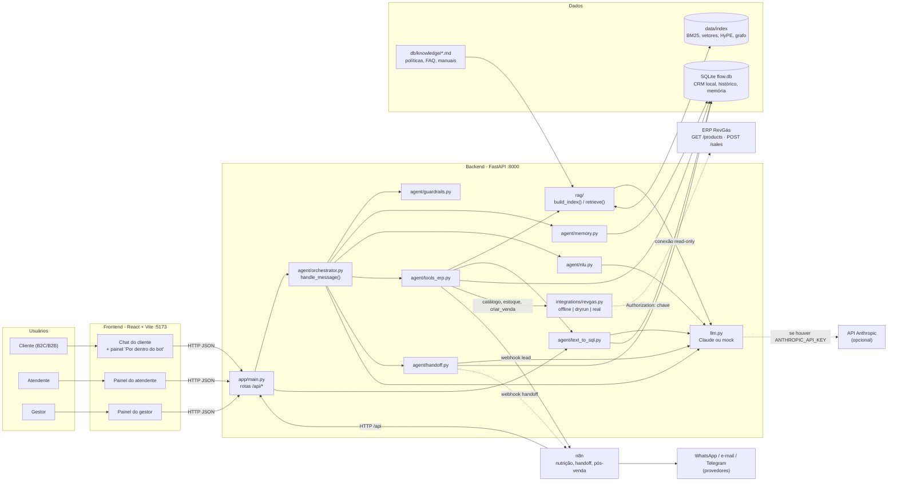
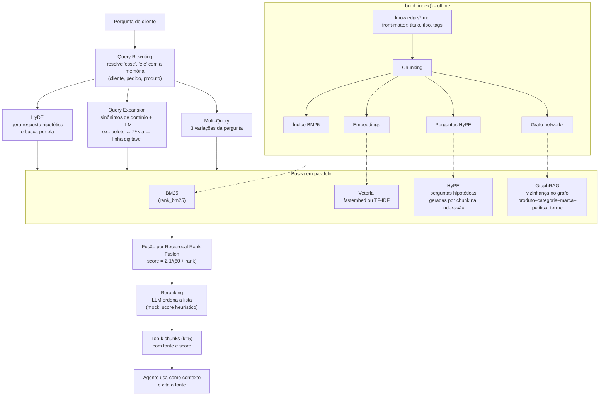
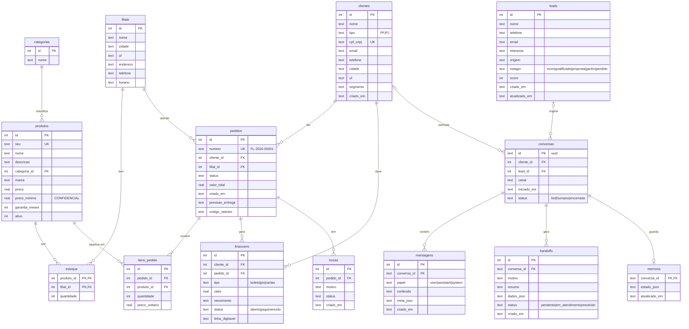
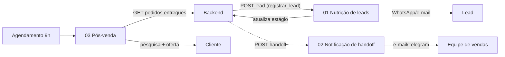

# Arquitetura do Flow Assistente

Este documento descreve os componentes, o caminho de uma mensagem pelo pipeline de 8 etapas,
o pipeline de recuperação (RAG) e o modelo de dados. A especificação de interfaces está em
[`../CONTRACT.md`](../CONTRACT.md).

## 1. Visão de componentes



Princípios de projeto:

- **Um ponto de acesso ao LLM** (`llm.py`). Isso permite o modo mock, que roda a apresentação
  sem chave de API e sem custo.
- **Ferramentas do ERP só leem** (`get_readonly_conn`), exceto `registrar_lead`,
  `transferir_atendente` e `criar_venda` (que só roda depois da confirmação explícita do cliente
  e só grava na RevGás com `REVGAS_MODO=real`).
- **Guardrails são código determinístico**, não instrução no prompt. Valem mesmo se o modelo
  errar.

## 2. Sequência de uma mensagem (8 etapas)

Exemplo: cliente já identificado pergunta *"meu pedido já saiu? e me dá um desconto na próxima
compra"*.

```mermaid
sequenceDiagram
    autonumber
    participant U as Cliente (Chat)
    participant API as FastAPI /api/chat
    participant GE as 1. Guardrails entrada
    participant M as 2. Memória
    participant N as 3. NLU (intenção + entidades)
    participant AG as 4. Agente (tool calling)
    participant R as RAG
    participant ERP as Ferramentas ERP (SQLite)
    participant SQL as 5. Text-to-SQL
    participant GS as 6. Guardrails saída
    participant H as 7. Handoff
    participant L as 8. Lead / n8n

    U->>API: POST {conversa_id, mensagem}
    API->>GE: verificar texto
    GE-->>API: ok (sem injeção, sem dado de terceiro, PII mascarada no log)
    API->>M: carregar slots
    M-->>API: {cliente_id, cpf_cnpj verificado, pedido_numero: FL-2026-00042}
    API->>N: classificar + extrair
    N-->>API: intenção consultar_pedido (0.9), pedir_desconto secundário
    API->>AG: mensagem + memória + NLU
    loop até resposta final (máx. N passos)
        AG->>ERP: consultar_pedido(FL-2026-00042)
        ERP-->>AG: status enviado, rastreio, previsão
        AG->>R: buscar_conhecimento("política de descontos")
        R-->>AG: chunks + RetrievalTrace
    end
    opt intenção relatorio_interno (atendente/gestor)
        AG->>SQL: pergunta em linguagem natural
        SQL-->>AG: SELECT validado em vw_* + linhas
    end
    AG-->>API: rascunho da resposta
    API->>GS: verificar rascunho
    GS-->>API: remove oferta de desconto, mascara CPF, nunca cita preco_minimo
    alt cliente pede humano, ou bot não resolve, ou pedido de desconto
        API->>H: criar handoff (resumo + dados)
        H-->>API: {id, resumo}; conversa = humano
    end
    opt interesse de compra
        API->>L: registrar_lead (score)
        L-->>L: POST N8N_WEBHOOK_URL (falha silenciosa)
    end
    API->>M: salvar slots atualizados
    API-->>U: {resposta, status_conversa, sugestoes, debug}
```

O objeto `debug` devolvido ao frontend registra o que aconteceu em cada etapa (intenção,
entidades, memória mascarada, trace de recuperação, chunks, ferramentas, SQL, guardrails,
handoff, técnicas, latência e modo do LLM).

## 3. Pipeline de recuperação (RAG)



Cada etapa pode ser ligada ou desligada pelo parâmetro `tecnicas` de `retrieve()`
(`rewrite, multi_query, expansion, hyde, hype, graph, hybrid, rerank`), o que permite
comparar resultados com e sem cada técnica.

## 4. Modelo de dados



### Views para Text-to-SQL

O Text-to-SQL só enxerga três views, sem colunas sensíveis (`preco_minimo`, CPF/CNPJ, e-mail,
telefone ficam de fora):

| View | Colunas |
|---|---|
| `vw_catalogo` | sku, nome, categoria, marca, preco, garantia_meses |
| `vw_estoque` | sku, produto, filial, cidade, quantidade |
| `vw_vendas_resumo` | mes, filial, qtd_pedidos, faturamento |

Validação com `sqlglot`: um único comando, só `SELECT`, só tabelas `vw_*`, `LIMIT` ≤ 50.
A execução usa conexão SQLite aberta em `mode=ro`, então mesmo um SQL que escape da
validação não consegue escrever.

## 5. Integração com n8n



Endpoints usados pelo n8n que ainda não constam do contrato estão listados em
[`../NOTES-docs.md`](../NOTES-docs.md).
